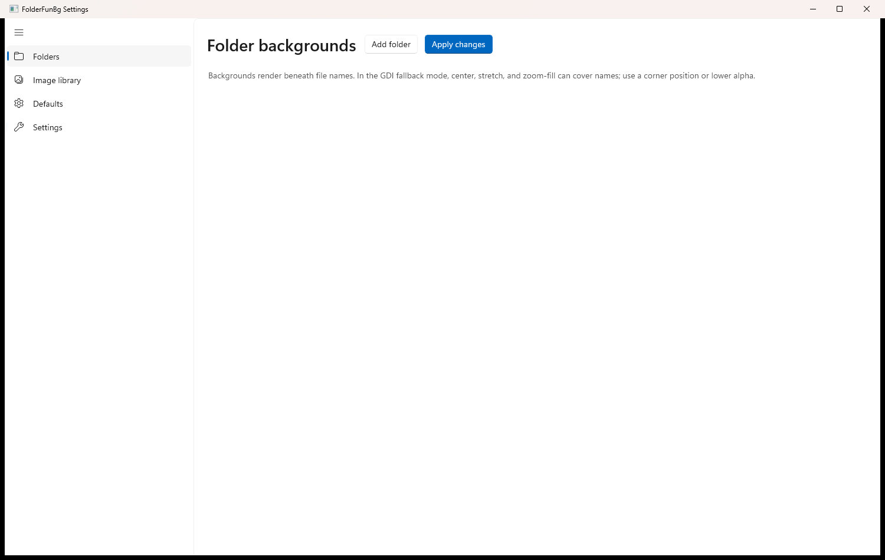
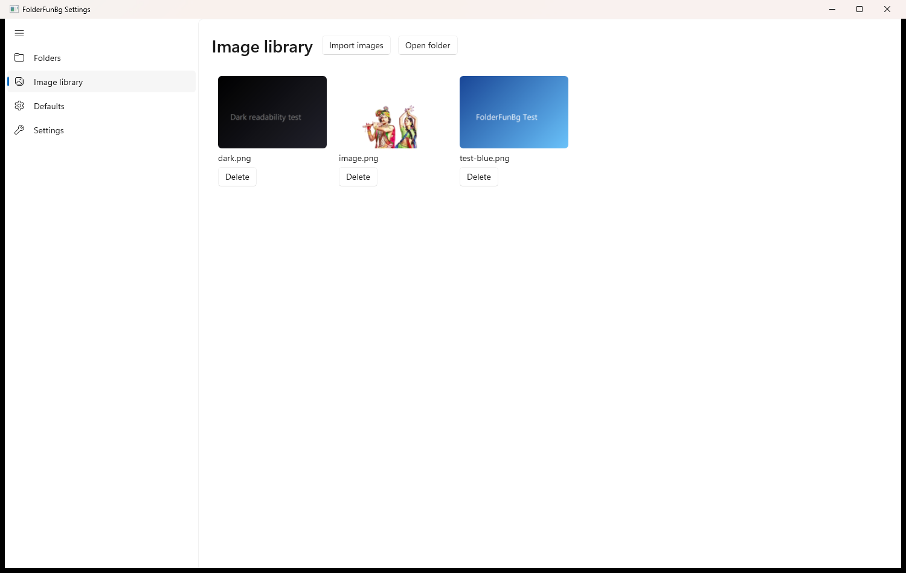
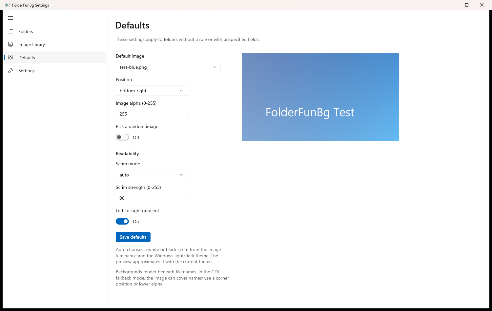
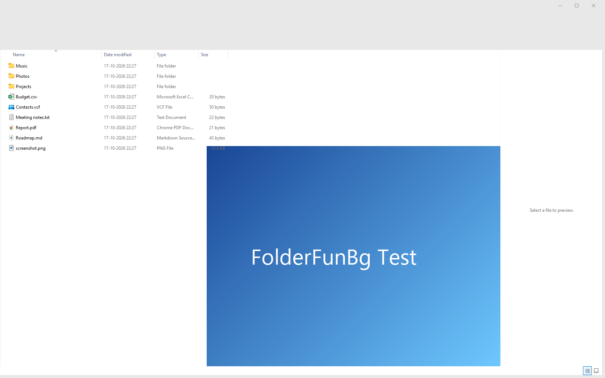
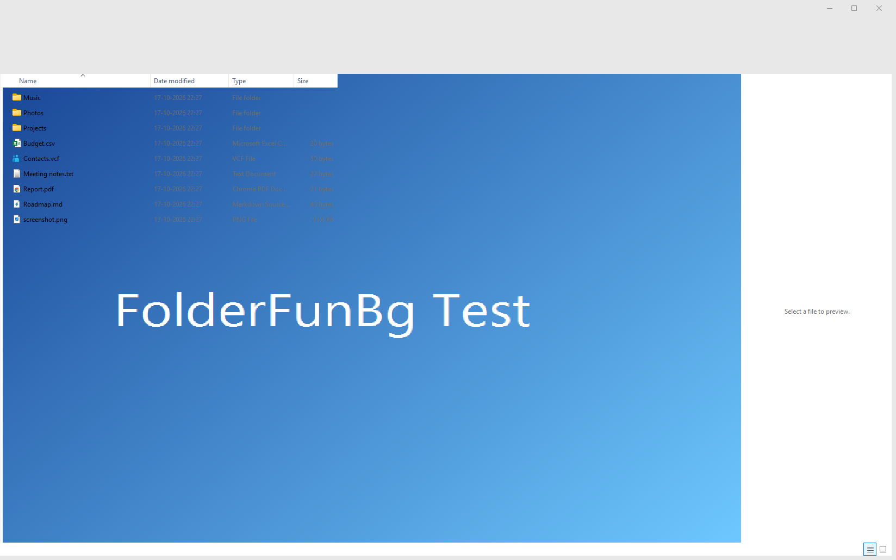
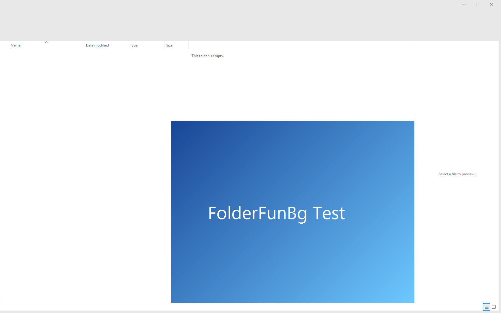
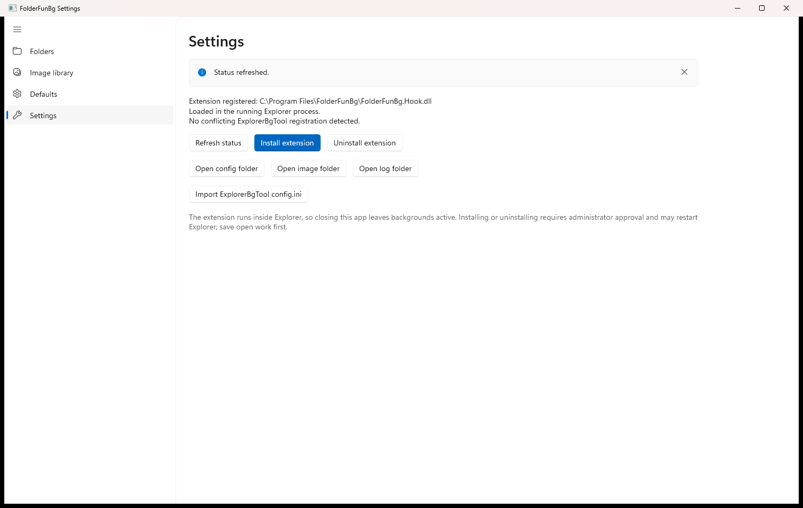

# FolderFunBg installation and setup guide

This guide is for anyone who wants to install FolderFunBg and give their File
Explorer windows their own background images. No programming knowledge is
needed. If you want to understand how it works internally, read the
[learner's tutorial](tutorial.md) afterwards.

> **Preview software.** FolderFunBg loads a native DLL inside `explorer.exe`
> and hooks an undocumented Windows rendering path. It works on the tested
> Windows 11 build, but a Windows update can break it. Keep a restore point or
> use a virtual machine if you are experimenting.

---

## 1. Requirements

| Requirement | Details |
|---|---|
| Windows | Windows 10 version 1809 or newer, or Windows 11 |
| Architecture | x64 (64-bit) |
| Permissions | Administrator, once, for installation |
| Disk space | About 250 MB for the installed app and hook |
| Runtime | None. The installer includes .NET and Windows App SDK |

The installer is **unsigned**. Windows SmartScreen may show an "unknown
publisher" warning the first time you run it. The release notes publish a
SHA-256 hash so you can verify the file before running it.

---

## 2. Download the installer

1. Open the [latest release](https://github.com/sjaauirs/FolderFunBg/releases/latest).
2. Download these two files:
   - `FolderFunBg-Setup.exe`
   - `FolderFunBg-Setup.exe.sha256`

### Verify the download (recommended)

Open PowerShell in the download folder and run:

```powershell
Get-FileHash .\FolderFunBg-Setup.exe -Algorithm SHA256
Get-Content .\FolderFunBg-Setup.exe.sha256
```

Both hashes must match. If they do not, delete the download and download it
again.

---

## 3. Install

1. Double-click `FolderFunBg-Setup.exe`.
2. Windows shows a **User Account Control** prompt. Click **Yes**. The installer
   needs administrator rights to write to `C:\Program Files` and register a COM
   shell extension.
3. The installer:
   - extracts the hook and the self-contained settings app,
   - installs them to `C:\Program Files\FolderFunBg`,
   - registers the Explorer extension,
   - creates a **FolderFunBg Settings** shortcut in the Start Menu,
   - restarts Explorer.

Your taskbar and open File Explorer windows will disappear for a moment while
Explorer restarts. Other applications are not closed.

A log of the installation is written to:

```text
C:\ProgramData\FolderFunBg\setup.log
```

If something fails, this log is the first place to look.

---

## 4. Open the settings app

Open the Start Menu, type **FolderFunBg Settings**, and press Enter. You can also
run:

```text
C:\Program Files\FolderFunBg\Settings\FolderFunBg.Settings.exe
```

The app has four pages: **Folders**, **Image library**, **Defaults**, and
**Settings**.



*The Folders page. Rules added here override the defaults for one folder.*

---

## 5. First-time setup

### 5.1 Add images to the library

1. Open **Image library**.
2. Click **Import images**.
3. Select one or more PNG or JPEG files.
4. Optionally click **Open folder** to see where the files are stored.



*Imported images are copied into `%LOCALAPPDATA%\FolderFunBg\Images`.*

Images are validated when imported, so a corrupt or renamed file is rejected
instead of being loaded inside Explorer.

### 5.2 Choose the default background

1. Open **Defaults**.
2. Pick a **Default image**.
3. Choose a **Position**:
   - `bottom-right`, `bottom-left`, `top-right`, `top-left` — keep the image
     away from the file-name column.
   - `center` — image in the middle; file names stay on top.
   - `stretch` — fill the view, possibly distorting the aspect ratio.
   - `zoom-fill` — fill the view while preserving the aspect ratio (crops).
4. Set **Image alpha** (0-255). Lower values make the image more subtle.
5. Choose a **Scrim mode**:
   - `auto` — picks a light or dark scrim from the image's brightness and the
     Windows light/dark theme. Recommended.
   - `light` / `dark` — force a white or black scrim.
   - `none` — no scrim.
6. Click **Save defaults**.



*The live preview uses the same position, alpha, and scrim settings as Explorer.*

### 5.3 Add a per-folder rule (optional)

Defaults apply to every folder. Use a rule when one folder should look
different.

1. Open **Folders** and click **Add folder**.
2. Choose a folder.
3. Pick an image, position, alpha, and optional readability override.
4. Enable **Recursive** if the rule should also apply to subfolders.
5. Click **Apply changes**.

Folder paths are matched case-insensitively. Exact rules win; otherwise the
longest matching recursive rule wins. Shell namespace folders such as **This
PC** can be targeted with a CLSID rule (`::{20D04FE0-3AEA-1069-A2D8-08002B30309D}`).

---

## 6. Verify that it works

Open any folder in File Explorer. The default background should appear behind
the file names and icons.



*The image is painted **behind** the list. File names and icons remain on top.*

This is easiest to see with a stretched image:



*The image fills the view, but file names, dates, and icons are still painted on
top.*

Empty folders also get the background:



If nothing changes:

- Open **Settings → Refresh status** and confirm the hook says **Loaded in the
  running Explorer process**.
- Check the log at `%LOCALAPPDATA%\FolderFunBg\Logs\FolderFunBg.log`.
- Make sure you clicked **Save defaults** or **Apply changes**.
- Restart Explorer once (Task Manager → Windows Explorer → Restart).



*The Settings page reports whether the extension is registered and loaded.*

---

## 7. Changing settings later

The settings app writes `config.json` atomically. The hook watches the file and
updates open Explorer windows without a restart, so changes usually appear
immediately.

Useful locations:

| What | Where |
|---|---|
| Configuration | `%LOCALAPPDATA%\FolderFunBg\config.json` |
| Images | `%LOCALAPPDATA%\FolderFunBg\Images` |
| Log | `%LOCALAPPDATA%\FolderFunBg\Logs\FolderFunBg.log` |
| Installer log | `C:\ProgramData\FolderFunBg\setup.log` |
| Installed app | `C:\Program Files\FolderFunBg` |

---

## 8. Uninstall

Run the installer you downloaded with the uninstall switch:

```powershell
.\FolderFunBg-Setup.exe --uninstall
```

The setup EXE is not copied into Program Files, so keep the downloaded file or
download it again from the release page.

The uninstaller unregisters the COM extension, removes the Start Menu shortcut
and the Program Files folder, and restarts Explorer. Your images and
`config.json` under `%LOCALAPPDATA%\FolderFunBg` are **kept** so a future
reinstall remembers your setup. Delete that folder manually if you want a
complete cleanup.

---

## 9. Troubleshooting

| Symptom | Likely cause | Fix |
|---|---|---|
| SmartScreen says "Windows protected your PC" | The EXE is unsigned | Click **More info → Run anyway** after verifying the SHA-256 |
| Installer does nothing after UAC | Explorer was auto-restarted and locked the old DLL | Re-run the installer; the current build stops Explorer before copying |
| No background in any folder | No image configured, config invalid, or hook not loaded | Check **Settings → Refresh status** and the hook log |
| Background only in some folders | A per-folder rule overrides the defaults | Check the **Folders** page |
| Image covers the file names | The GDI fallback is active or another hook tool is installed | Remove other Explorer hook tools; update to the DirectUI build |
| Black background with black text | A very dark image with readability `none` and the Windows light theme | Choose `auto` readability or a lighter image |
| Explorer feels slow | Very large images or a pathological scrim | Use smaller images and a corner position |
| App will not start | Missing files in `C:\Program Files\FolderFunBg\Settings` | Reinstall; the app is self-contained and needs no separate runtime |

If Explorer keeps crashing after an update, uninstall FolderFunBg, then check
Windows Update and the project's issue tracker. Windows shell internals change
between builds.

---

## 10. Safety notes

- FolderFunBg runs inside Explorer with your normal user privileges. Only
  install builds you trust.
- It does not collect telemetry, open network connections, or require a
  background service.
- The settings app is a normal desktop app; closing it leaves backgrounds
  active because Explorer owns the hook.
- Do not run FolderFunBg together with another tool that hooks Explorer's
  drawing path. Two detour stacks can crash the shell.
- The project is MIT licensed. MinHook and `nlohmann/json` keep their own
  licenses; see `LICENSE` and `NOTICE.md`.

---

## Next steps

- Read the [learner's tutorial](tutorial.md) to see how the hook works.
- Read the [architecture notes](architecture.md) for the file-by-file design.
- Try the [beginner exercises](learning/10-exercises.md) if you want to extend
  the project.
